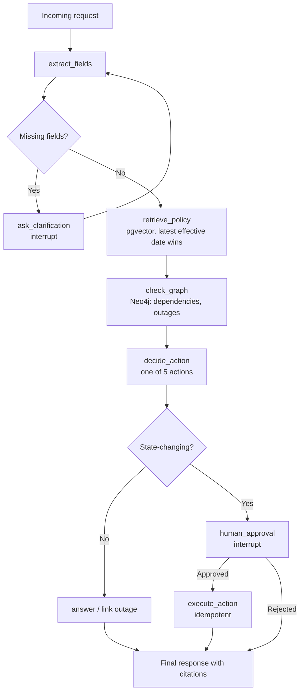

# HelpDesk Lite

**An agentic AI assistant for IT support engineers: faster first-correct-answer, with a human accountable for every state-changing action.**

[](#project-status)
[](#technology-stack)
[](#technology-stack)
[](./LICENSE)

Code.Hub · PwC · Agentic AI Bootcamp

---

## Table of Contents

1. [Overview](#overview)
2. [Key Capabilities](#key-capabilities)
3. [Architecture](#architecture)
4. [Technology Stack](#technology-stack)
5. [Project Status](#project-status)
6. [Getting Started](#getting-started)
7. [Live Demo Execution Guide (10 Minutes)](#live-demo-execution-guide-10-minutes)
8. [Automated Testing Suite](#automated-testing-suite)
9. [Governance and Constraints](#governance-and-constraints)
10. [Team Model](#team-model)
11. [Delivery Plan](#delivery-plan)
12. [Evaluation](#evaluation)
13. [Definition of Done](#definition-of-done)
14. [Contributing](#contributing)
15. [Documentation](#documentation)
16. [License](#license)

---

## Overview

HelpDesk Lite reduces the time between an incoming IT support request and the first correct response. The assistant extracts the relevant facts from a request, consults company policies and a service dependency graph, and proposes exactly one of five actions. Any action that changes an account or a system pauses for explicit human approval and survives application restarts.

This repository is the team's warm-up project. Its purpose is to establish a shared stack and prove that the core building blocks work before the final project begins.

## Key Capabilities

| # | Capability | Description |
|---|------------|-------------|
| 1 | Field extraction | Extracts `employee`, `application`, `symptom` and `urgency` from the request. |
| 2 | Clarification | Asks follow-up questions when essential details are missing; never guesses. |
| 3 | Policy retrieval | Searches the policy document store and cites the source and **effective date**. |
| 4 | Service graph check | Inspects dependencies and active outages. |
| 5 | Action proposal | Selects one of: answer from policy, link to outage, reset credentials, open ticket, escalate to an engineer. |
| 6 | Human-in-the-loop | Halts and waits for approval before any account-changing or ticket-creating action. |
| 7 | Persistence | Resumes the conversation from the same point after an application restart. |

## Architecture



### Design Principles

- **No silos.** Each role has a primary owner but no exclusive knowledge; pair sessions and review rotation are mandatory.
- **Walking skeleton first.** Build an end-to-end flow with mocks early, then replace the mocks incrementally.
- **Contracts before code.** State schema, Pydantic models and tool signatures are agreed up front.
- **Simple business logic.** The value lies in the stack and patterns: interrupt, checkpoint and tracing.

### Critical Implementation Notes

| Topic | Guidance |
|-------|----------|
| Interrupt and checkpointing | Map `thread_id` consistently to the Chainlit session so the correct thread is found after a restart. |
| Idempotency | Persist an `action_id` and status (`pending → approved → executed`) and check it before execution. |
| Policy versions | Store `effective_date` and `doc_id` as metadata; retrieval keeps the most recent version. |
| Service dependencies | If an application depends on a service with an active outage, the correct action is *link to outage*, not a credential reset. |

## Technology Stack

| Technology | Purpose |
|------------|---------|
| LangGraph | Workflow, state, interrupts |
| Chainlit | UI: chat, progress, approval buttons |
| LangChain Core | Prompts, models, tools, Pydantic |
| Docker Compose | Service orchestration |
| PostgreSQL + pgvector | Tickets, LangGraph checkpoints, semantic policy search |
| Neo4j | Employees, teams, applications, services, outages |
| LangSmith | Tracing and evaluation |

## Project Status

The project is in its initial phase. This repository currently contains the project documentation; implementation artifacts are planned deliverables.

| Deliverable | Status |
|-------------|--------|
| Documentation (project notes, Git guide) | Available in [`docs/`](./docs) |
| `docker-compose.yml` and `.env.example` | Available |
| Chainlit application | Available (Integrated LangGraph + Chainlit UI with human approval & restart resilience) |
| Policy ingestion and graph seeding scripts | Available (Automated in Compose via `seed` service) |
| LangSmith project with evaluation run (10 requests) | Available (10-scenario evaluation suite with automated LangSmith evaluators) |
| `CONTRIBUTING.md` (team agreement) | Available in [`CONTRIBUTING.md`](./CONTRIBUTING.md) |
| 10-minute live demo, including resume after restart | Ready / Documented (Step-by-step 10-minute live demo rehearsal guide) |

## Getting Started

Follow these instructions to start the entire HelpDesk Lite stack from a clean clone. The full stack boots up in **<10 minutes**.

### Prerequisites

- [Docker Engine](https://docs.docker.com/engine/install/) (24.0+)
- [Docker Compose](https://docs.docker.com/compose/install/) (v2.24.0+)

### Quick Start (One-Command Startup)

```bash
# 1. Clone the repository
git clone https://github.com/vaggelismpomponis/helpdesk_lite.git
cd helpdesk_lite

# 2. Configure environment variables (copy template)
# Linux / macOS:
cp .env.example .env

# Windows (PowerShell):
Copy-Item .env.example .env

# Windows (CMD):
copy .env.example .env

# 3. Start all services (PostgreSQL + pgvector, Neo4j, Chainlit App)
docker compose up -d --build
```

### Accessing Services

Once started, verify that all containers report `healthy`:

```bash
docker compose ps
```

| Service | Endpoint | Credentials / Details |
|---------|----------|-----------------------|
| **Chainlit UI** | [http://localhost:8000](http://localhost:8000) | IT Support Assistant interactive web chat |
| **Neo4j Browser** | [http://localhost:7474](http://localhost:7474) | User: `neo4j` / Password: `neo4j_secure_password`<br>Bolt protocol: `bolt://localhost:7687` |
| **PostgreSQL + pgvector** | `localhost:5432` | DB: `helpdesk` / User: `postgres` / Password: `postgres_secure_password`<br>Extension `vector` enabled |

### Common Operations

```bash
# View application logs
docker compose logs -f app

# View logs for all services
docker compose logs -f

# Restart the application service (preserves DB volumes)
docker compose restart app

# Stop the stack
docker compose down

# Stop the stack and remove persistent data volumes
docker compose down -v
```

### Container Restart & Idempotency Testing

HelpDesk Lite is architected to withstand container restarts, crashes, and message replays without losing user conversation state or duplicating approved state-changing actions:

- **Persistent Checkpoints (`PostgresSaver`)**: LangGraph conversation threads and interrupted approval states are stored directly in PostgreSQL (`checkpoints`, `checkpoint_blobs`, `checkpoint_writes` tables) backed by the persistent `postgres_data` volume.
- **Graceful Shutdown**: The `app` service is configured with `stop_grace_period: 15s` in `docker-compose.yml` to allow in-flight database transactions and checkpointer writes to complete cleanly prior to container restart or shutdown.
- **Strict Idempotency Guard**: All proposed and executed actions are tracked in PostgreSQL (`audit_log` and `tickets` tables) with unique `action_id` constraints and row-level locking (`SELECT ... FOR UPDATE`), guaranteeing approved actions never re-execute upon container recovery.

To verify container restart and idempotency behavior:

```bash
# Test 1: Warm restart of app container (Postgres and Neo4j stay active)
docker compose restart app

# Test 2: Restart full stack (preserves persistent named volumes)
docker compose down && docker compose up -d

# Test 3: Run automated restart & idempotency verification suite
pytest tests/test_restart_idempotency.py -v
```

### Automated Ingestion & Database Seeding

Knowledge base policy documents (with chunk embeddings in `pgvector`) and the Neo4j service dependency graph are **automatically seeded** upon startup by the `seed` container before the `app` container starts. No manual SQL or database manipulation is required.

To re-run seeding on demand at any time (verified idempotent execution):

```bash
# Using Docker Compose (recommended)
docker compose run --rm seed

# Or directly via Python CLI (requires active database connections)
python scripts/seed.py
```

### Upgrading Existing Database Volumes

If you have an existing PostgreSQL Docker volume (`postgres_data`) from an earlier version of the stack, run the non-destructive upgrade migration to backfill tickets and add required audit log and LangGraph checkpoint tables:

```bash
docker compose exec -T postgres psql -U postgres -d helpdesk < docker/postgres/migrations/001_upgrade_schema.sql
```

### Cross-Platform & Clean-Clone Troubleshooting

If you encounter issues during a clean clone on your operating system, check the following resolutions:

| Friction Point | Platform | Cause & Resolution |
|---|---|---|
| **Line Endings (CRLF / LF)** | Windows | Git on Windows may convert LF to CRLF by default. The repository includes [`.gitattributes`](./.gitattributes) enforcing LF line endings for all scripts, SQL, and Docker files. Ensure you do not override `core.autocrlf` locally. |
| **Windows Command Syntax** | Windows | In Windows `cmd.exe`, `cp` is not recognized and inline `#` comments cause syntax errors. Use `copy .env.example .env` (CMD) or `Copy-Item .env.example .env` (PowerShell) on separate lines. |
| **Port Conflicts (5432, 7474, 7687, 8000)** | All | If a service is already running on port 5432 (local Postgres), 7474/7687 (local Neo4j), or 8000 (local web app), modify the corresponding port in your `.env` file (e.g. `POSTGRES_PORT=5433`, `NEO4J_HTTP_PORT=7475`, `NEO4J_BOLT_PORT=7688`, `APP_PORT=8001`) without modifying `docker-compose.yml`. |
| **Docker Daemon Socket Permission** | Linux | If `docker compose up` returns `permission denied while trying to connect to the Docker daemon socket`, grant your user docker privileges: `sudo usermod -aG docker $USER` and log back in or run `newgrp docker`. |
| **Compose Syntax Error on `required: false`** | Linux / macOS | Requires Docker Compose **v2.24.0+**. Verify your version with `docker compose version`. On older Linux package manager installs, upgrade Docker Compose plugin via official Docker repositories. |
| **Neo4j Startup Delay (JVM Warmup)** | All | Neo4j JVM initialization takes 20–40 seconds on cold start. The healthcheck includes `start_period: 30s` with 12 retries to prevent false-unhealthy states. |
| **Offline / Network-Isolated Mode** | All | If external LLM API endpoints or Azure credentials are unavailable, knowledge ingestion and embedding gracefully fall back to deterministic hash embeddings without crashing. |
| **Stale Volume State** | All | If database schemas or volume files are in an inconsistent state from previous testing, run `docker compose down -v` to wipe named volumes and trigger clean initialization. |

For detailed clean-clone benchmark results (<10 minutes across Windows, macOS, and Linux), see [`docs/CLEAN_CLONE_BENCHMARK.md`](./docs/CLEAN_CLONE_BENCHMARK.md).

For Git setup, branching and pull request workflow, see the [Git Guide](./docs/GIT_GUIDE.md).

## Live Demo Execution Guide (10 Minutes)

This step-by-step rehearsal guide demonstrates the full HelpDesk Lite capabilities during the 10-minute team presentation. Any team member can present any part of the rotation.

### Pre-Demo Checklist
1. Ensure the stack is running: `docker compose up -d`
2. Verify all containers are healthy: `docker compose ps`
3. Open Chainlit UI in your browser: [http://localhost:8000](http://localhost:8000)
4. Open Neo4j Browser in a second tab: [http://localhost:7474](http://localhost:7474) (Credentials: `neo4j` / `neo4j_secure_password`)
5. Open LangSmith dashboard in a third tab to observe live trace telemetry.

---

### Phase 1: Overview & Architecture (1 Minute)
- **Presenter:** Platform or Quality role.
- **Narrative:**
  - Introduce HelpDesk Lite: IT support assistant designed for faster first-correct-answer with zero autonomous state-changing operations.
  - Highlight the core architectural contracts: LangGraph state machine, PostgreSQL checkpoints (`PostgresSaver`), Neo4j dependency graph, pgvector semantic policy search, and Chainlit web UI.
  - Explain the 5 action types (`answer_policy`, `link_outage`, `reset_credentials`, `open_ticket`, `escalate`) and the human-in-the-loop guarantee.

---

### Phase 2: Missing Details & Clarification (2 Minutes)
- **Presenter:** Interface or Workflow role.
- **Goal:** Demonstrate that the assistant extracts mandatory fields (`employee`, `application`, `symptom`, `urgency`) and halts with a polite clarification rather than hallucinating or guessing.
- **User Prompt in UI:**
  > *"I cannot log in to my account. Please help!"*
- **Assistant Behavior:**
  - Identifies that `employee` identity and `application` are missing.
  - Proposes `ask_clarification` and pauses for human response.
  - Replies: *"Could you please specify your employee username or ID, and which application you are attempting to access?"*
- **User Follow-Up:**
  > *"My name is Alice and I am trying to access SAP ERP."*
- **Assistant Behavior:**
  - Extracts `employee: Alice`, `application: SAP ERP`.
  - Resumes the graph flow to consult policies and the service dependency graph.

---

### Phase 3: Policy Retrieval & Conflict Resolution (2 Minutes)
- **Presenter:** Knowledge role.
- **Goal:** Demonstrate semantic retrieval from PostgreSQL `pgvector` where multiple versions of a policy exist, proving the system selects the **latest effective date** and cites both `doc_id` and `effective_date`.
- **User Prompt in UI:**
  > *"Alice from Finance: What is the maximum password retry limit before account lockout on SAP ERP?"*
- **Assistant Behavior:**
  - Queries `policy_chunks` table via vector similarity.
  - Detects legacy policy `POL-SEC-01-v1` (effective 2023-01-01, 3 retries) and superseding policy `POL-SEC-01-v2` (effective 2024-06-01, 5 retries).
  - Selects `POL-SEC-01-v2` based on effective date precedence.
  - Proposes action `answer_policy` and responds with explicit citations:
    > *"Per company password policy **POL-SEC-01-v2** (effective **2024-06-01**), accounts are locked after 5 consecutive failed login attempts."*

---

### Phase 4: Service Dependency & Active Outage (2 Minutes)
- **Presenter:** Knowledge or Workflow role.
- **Goal:** Prove that the assistant inspects Neo4j for service dependencies and active outages, correctly proposing `link_outage` instead of an erroneous credential reset.
- **User Prompt in UI:**
  > *"Bob from Sales: Salesforce CRM is returning 500 error and won't let me sign in. Reset my password!"*
- **Assistant Behavior:**
  - Checks Neo4j dependency graph: `Salesforce CRM` depends on `Auth0 Identity Gateway`.
  - Discovers an active critical outage on `Auth0 Identity Gateway` (`OUT-2026-11-04`).
  - Correctly suppresses credential reset; proposes `link_outage`.
  - Responds with outage incident reference and status:
    > *"Salesforce CRM is currently impacted by active incident **OUT-2026-11-04** on dependent service **Auth0 Identity Gateway**. We recommend linking your request to the ongoing outage rather than resetting credentials."*

---

### Phase 5: Human-in-the-Loop, Container Restart & Resumed Idempotency (2 Minutes)
- **Presenter:** Platform or Interface role.
- **Goal:** The showstopper feature — trigger a state-changing action, demonstrate the interrupt card, perform a hard container restart, show state recovery from PostgreSQL checkpoint, approve the action, and prove zero duplicate execution.
- **Step 1: Trigger State-Changing Action**
  - User Prompt in UI:
    > *"Alice: My Workday credentials are lost and there are no active outages. Please reset my password."*
  - Assistant analyzes request, verifies no outage, and proposes `reset_credentials` (`pending`).
  - UI displays the interactive Approval Card: **[Approve]** and **[Reject]** buttons.
- **Step 2: Simulate Container Crash / Restart**
  - Switch to terminal and execute:
    ```bash
    docker compose restart app
    ```
  - Verify terminal output: `Container helpdesk_app Restarted`.
- **Step 3: Resume Conversation Seamlessly**
  - Return to browser and refresh or click **[Approve]**.
  - Assistant announces:
    > *"🔄 Session restored from database checkpoint! Resuming thread..."*
  - The pending approval card is intact.
- **Step 4: Execute with Strict Idempotency**
  - Click **[Approve]**.
  - Action transitions from `pending → approved → executed` inside PostgreSQL transaction with row-level locking.
  - Click **[Approve]** a second time (or replay message):
  - Assistant safely reports: *"Action was already executed under action_id act_... No duplicate operation performed."*

---

### Phase 6: Traces and Evaluation in LangSmith (1 Minute)
- **Presenter:** Quality role.
- **Goal:** Show observability and eval metrics.
- **Action:**
  - Open LangSmith UI to inspect the live execution trace for the session.
  - Highlight the exact node transitions (`extract_fields → retrieve_policy → check_graph → decide_action → human_approval → execute_action`).
  - Demonstrate the 10-scenario evaluation benchmark results (`eval/evaluators.py`), confirming 100% adherence to policy citations, outage linking, and human approval constraints.

---

## Automated Testing Suite

The repository contains an automated test suite verifying container configurations, database schemas, graph logic, and restart idempotency across all platforms:

```bash
# Run all test suites inside the Docker container runner:
docker compose run --rm app pytest tests/ -v

# Run individual test suites:
# 1. Platform & Docker stack configuration tests
docker compose run --rm app pytest tests/test_docker_stack.py -v

# 2. PostgreSQL schema, pgvector, and checkpointer migration tests
docker compose run --rm app pytest tests/test_postgres_schema.py -v

# 3. LangGraph agent nodes, routing, and approval interrupts
docker compose run --rm app pytest tests/test_graph.py -v

# 4. Knowledge ingestion, chunking, and Neo4j graph tools
docker compose run --rm app pytest tests/test_knowledge.py -v

# 5. Container restart resilience & idempotency verification
docker compose run --rm app pytest tests/test_restart_idempotency.py -v

# 6. Evaluation dataset & LangSmith evaluator contracts (10 scenarios)
docker compose run --rm app pytest tests/test_evaluators.py -v
```

## Governance and Constraints

**Requirements**

- No action is executed without explicit human approval.
- A restart must never execute an approved action **twice** (idempotency).
- When policy versions conflict, the document with the most recent effective date prevails.
- Service dependencies must be taken into account in every decision.

**Out of scope:** multi-agent patterns, MCP, additional vector stores, model training, adversarial testing.

### Risk Register

| Risk | Mitigation |
|------|------------|
| "Works on my machine" | Docker, pinned versions, clean-clone test |
| Duplicate execution after restart | Persisted status, pre-execution check, restart test |
| LLM guesses missing fields | Optional Pydantic fields and an "if missing, ask" rule |
| Wrong policy version | `effective_date` metadata, sorting, dedicated test case |
| Team member cannot explain the flow | Review and rehearsal rotation |
| Scope creep | Adhere to the out-of-scope list |
| Platform delays | All members assist on days 2–3 |
| Non-repeatable demo | Demo script, seed data, restart rehearsal |

## Team Model

Five recommended roles, each with a primary owner and a backup. Every member commits code.

| Role | Primary Responsibility | Deliverables |
|------|------------------------|--------------|
| **Platform** | Docker Compose, Postgres + pgvector, Neo4j, `.env.example`, README | Stack that starts with one command in <10 min |
| **Interface** | Chainlit UI: chat, progress steps, Approve/Reject buttons, resume | Working UI |
| **Workflow** | LangGraph nodes, edges, state, interrupt, PostgresSaver, idempotency | Graph with approval and resume |
| **Knowledge** | Policy ingestion (chunking, embeddings, effective-date metadata), Neo4j seeding, retrieval and graph tools | Scripts and tools |
| **Quality** | LangSmith tracing, 10-request dataset, evaluators, `CONTRIBUTING.md`, test scenarios, demo | Evaluation run and demo script |

### Working Agreements

- Daily stand-up (10–15 min, asynchronous is acceptable).
- Small pull requests (<300 lines) reviewed within 24 hours; no self-merge.
- Review rotation, a mid-week pair/mob session and weekly integration time.

## Delivery Plan

Two-week timeline.

| Timing | Milestone |
|--------|-----------|
| Week 1, session 1 | Kick-off, roles, repository, team agreement |
| End of week 1 | Full stack runs on all laptops (clean-clone test using only the README) |
| Mid week 2 | End-to-end flow with approval and resume |
| End of week 2 | Evaluation run and final demo |

## Evaluation

**Criteria**

- Correct citation of documents and effective dates.
- Every action is traceable in LangSmith.
- All 10 evaluation requests complete with the expected actions.
- Every member can explain the entire flow during the demo.

**Proposed 10-request test set**

| Count | Scenario |
|-------|----------|
| 2 | Simple questions answered from policy |
| 1–2 | Old and new versions of the same policy |
| 2 | Active outage on a dependent service |
| 2 | Credential reset (with approval) |
| 1 | Ticket creation |
| 1 | Escalation |
| 1 | Incomplete details (clarification) |

**Demo outline (10 minutes):** goal and architecture (1′) · missing details and clarification (2′) · policy with citation and effective date (2′) · outage and service dependency (2′) · approved action, **restart** and resume without duplicate execution (2′) · LangSmith traces and evaluation (1′).

## Definition of Done

- [x] `docker compose up` starts all services in <10 minutes from a clean clone.
- [x] Ingestion and seeding scripts run without manual steps.
- [x] No state-changing action without approval.
- [x] Resume after restart works, with no duplicate execution.
- [x] Citations include source and effective date.
- [x] Traces in LangSmith and an evaluation run over 10 requests.
- [x] `CONTRIBUTING.md` completed and every member has commits.
- [x] Everyone can explain the entire flow.

## Contributing

Work follows a `main` / `develop` model with short-lived feature branches and reviewed pull requests.

- `main`: stable, release-ready code. `develop`: integration branch.
- Create feature branches from `develop` using the `feature/`, `bugfix/`, `hotfix/` or `docs/` prefix.
- Open pull requests into `develop`; at least one reviewer approves, and the reviewer performs the merge.
- Never commit secrets or credentials.

Full instructions, including web UI walkthroughs, are in the [Git Guide](./docs/GIT_GUIDE.md). The team agreement will be recorded in `CONTRIBUTING.md`.

## Documentation

| Document | Description |
|----------|-------------|
| [Project Notes](./docs/PROJECT_NOTES.md) | Project summary, five-person team plan, and merging pull requests on Codeberg (Greek) |
| [Git Guide](./docs/GIT_GUIDE.md) | Git workflow, branching strategy, pull requests and conflict resolution (Greek) |

Repository: <https://codeberg.org/ebomponis001/HelpDesk_Lite>

## License

Distributed under the terms of the [LICENSE](./LICENSE) file.
