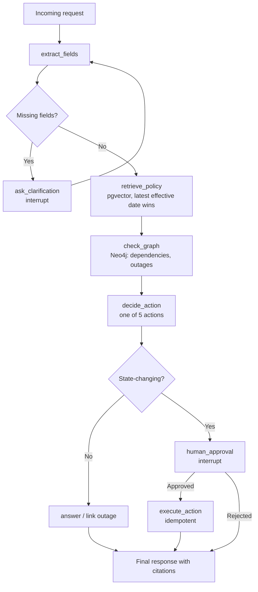

# HelpDesk Lite

**An agentic AI assistant for IT support engineers: faster first-correct-answer, with a human accountable for every state-changing action.**

[](#project-status)
[](#technology-stack)
[](#technology-stack)
[](./LICENSE)

Code.Hub · PwC · Agentic AI Bootcamp

---

## Table of Contents

1. [Overview](#overview)
2. [Key Capabilities](#key-capabilities)
3. [Architecture](#architecture)
4. [Technology Stack](#technology-stack)
5. [Project Status](#project-status)
6. [Getting Started](#getting-started)
7. [Governance and Constraints](#governance-and-constraints)
8. [Team Model](#team-model)
9. [Delivery Plan](#delivery-plan)
10. [Evaluation](#evaluation)
11. [Definition of Done](#definition-of-done)
12. [Contributing](#contributing)
13. [Documentation](#documentation)
14. [License](#license)

---

## Overview

HelpDesk Lite reduces the time between an incoming IT support request and the first correct response. The assistant extracts the relevant facts from a request, consults company policies and a service dependency graph, and proposes exactly one of five actions. Any action that changes an account or a system pauses for explicit human approval and survives application restarts.

This repository is the team's warm-up project. Its purpose is to establish a shared stack and prove that the core building blocks work before the final project begins.

## Key Capabilities

| # | Capability | Description |
|---|------------|-------------|
| 1 | Field extraction | Extracts `employee`, `application`, `symptom` and `urgency` from the request. |
| 2 | Clarification | Asks follow-up questions when essential details are missing; never guesses. |
| 3 | Policy retrieval | Searches the policy document store and cites the source and **effective date**. |
| 4 | Service graph check | Inspects dependencies and active outages. |
| 5 | Action proposal | Selects one of: answer from policy, link to outage, reset credentials, open ticket, escalate to an engineer. |
| 6 | Human-in-the-loop | Halts and waits for approval before any account-changing or ticket-creating action. |
| 7 | Persistence | Resumes the conversation from the same point after an application restart. |

## Architecture



### Design Principles

- **No silos.** Each role has a primary owner but no exclusive knowledge; pair sessions and review rotation are mandatory.
- **Walking skeleton first.** Build an end-to-end flow with mocks early, then replace the mocks incrementally.
- **Contracts before code.** State schema, Pydantic models and tool signatures are agreed up front.
- **Simple business logic.** The value lies in the stack and patterns: interrupt, checkpoint and tracing.

### Critical Implementation Notes

| Topic | Guidance |
|-------|----------|
| Interrupt and checkpointing | Map `thread_id` consistently to the Chainlit session so the correct thread is found after a restart. |
| Idempotency | Persist an `action_id` and status (`pending → approved → executed`) and check it before execution. |
| Policy versions | Store `effective_date` and `doc_id` as metadata; retrieval keeps the most recent version. |
| Service dependencies | If an application depends on a service with an active outage, the correct action is *link to outage*, not a credential reset. |

## Technology Stack

| Technology | Purpose |
|------------|---------|
| LangGraph | Workflow, state, interrupts |
| Chainlit | UI: chat, progress, approval buttons |
| LangChain Core | Prompts, models, tools, Pydantic |
| Docker Compose | Service orchestration |
| PostgreSQL + pgvector | Tickets, LangGraph checkpoints, semantic policy search |
| Neo4j | Employees, teams, applications, services, outages |
| LangSmith | Tracing and evaluation |

## Project Status

The project is in its initial phase. This repository currently contains the project documentation; implementation artifacts are planned deliverables.

| Deliverable | Status |
|-------------|--------|
| Documentation (project notes, Git guide) | Available in [`docs/`](./docs) |
| `docker-compose.yml` and `.env.example` | Planned |
| Chainlit application | Planned |
| Policy ingestion and graph seeding scripts | Planned |
| LangSmith project with evaluation run (10 requests) | Planned |
| `CONTRIBUTING.md` (team agreement) | Planned |
| 10-minute live demo, including resume after restart | Planned |

## Getting Started

> Setup instructions will be completed once the Platform deliverables land. The target is for **all services to start in under 10 minutes** from a clean clone.

```bash
git clone https://codeberg.org/ebomponis001/HelpDesk_Lite.git
cd HelpDesk_Lite
```

Target workflow once the stack is available:

```bash
cp .env.example .env      # configure credentials and LangSmith settings
docker compose up         # start all services
```

For Git setup, branching and pull request workflow, see the [Git Guide](./docs/GIT_GUIDE.md).

## Governance and Constraints

**Requirements**

- No action is executed without explicit human approval.
- A restart must never execute an approved action **twice** (idempotency).
- When policy versions conflict, the document with the most recent effective date prevails.
- Service dependencies must be taken into account in every decision.

**Out of scope:** multi-agent patterns, MCP, additional vector stores, model training, adversarial testing.

### Risk Register

| Risk | Mitigation |
|------|------------|
| "Works on my machine" | Docker, pinned versions, clean-clone test |
| Duplicate execution after restart | Persisted status, pre-execution check, restart test |
| LLM guesses missing fields | Optional Pydantic fields and an "if missing, ask" rule |
| Wrong policy version | `effective_date` metadata, sorting, dedicated test case |
| Team member cannot explain the flow | Review and rehearsal rotation |
| Scope creep | Adhere to the out-of-scope list |
| Platform delays | All members assist on days 2–3 |
| Non-repeatable demo | Demo script, seed data, restart rehearsal |

## Team Model

Five recommended roles, each with a primary owner and a backup. Every member commits code.

| Role | Primary Responsibility | Deliverables |
|------|------------------------|--------------|
| **Platform** | Docker Compose, Postgres + pgvector, Neo4j, `.env.example`, README | Stack that starts with one command in <10 min |
| **Interface** | Chainlit UI: chat, progress steps, Approve/Reject buttons, resume | Working UI |
| **Workflow** | LangGraph nodes, edges, state, interrupt, PostgresSaver, idempotency | Graph with approval and resume |
| **Knowledge** | Policy ingestion (chunking, embeddings, effective-date metadata), Neo4j seeding, retrieval and graph tools | Scripts and tools |
| **Quality** | LangSmith tracing, 10-request dataset, evaluators, `CONTRIBUTING.md`, test scenarios, demo | Evaluation run and demo script |

### Working Agreements

- Daily stand-up (10–15 min, asynchronous is acceptable).
- Small pull requests (<300 lines) reviewed within 24 hours; no self-merge.
- Review rotation, a mid-week pair/mob session and weekly integration time.

## Delivery Plan

Two-week timeline.

| Timing | Milestone |
|--------|-----------|
| Week 1, session 1 | Kick-off, roles, repository, team agreement |
| End of week 1 | Full stack runs on all laptops (clean-clone test using only the README) |
| Mid week 2 | End-to-end flow with approval and resume |
| End of week 2 | Evaluation run and final demo |

## Evaluation

**Criteria**

- Correct citation of documents and effective dates.
- Every action is traceable in LangSmith.
- All 10 evaluation requests complete with the expected actions.
- Every member can explain the entire flow during the demo.

**Proposed 10-request test set**

| Count | Scenario |
|-------|----------|
| 2 | Simple questions answered from policy |
| 1–2 | Old and new versions of the same policy |
| 2 | Active outage on a dependent service |
| 2 | Credential reset (with approval) |
| 1 | Ticket creation |
| 1 | Escalation |
| 1 | Incomplete details (clarification) |

**Demo outline (10 minutes):** goal and architecture (1′) · missing details and clarification (2′) · policy with citation and effective date (2′) · outage and service dependency (2′) · approved action, **restart** and resume without duplicate execution (2′) · LangSmith traces and evaluation (1′).

## Definition of Done

- [ ] `docker compose up` starts all services in <10 minutes from a clean clone.
- [ ] Ingestion and seeding scripts run without manual steps.
- [ ] No state-changing action without approval.
- [ ] Resume after restart works, with no duplicate execution.
- [ ] Citations include source and effective date.
- [ ] Traces in LangSmith and an evaluation run over 10 requests.
- [ ] `CONTRIBUTING.md` completed and every member has commits.
- [ ] Everyone can explain the entire flow.

## Contributing

Work follows a `main` / `develop` model with short-lived feature branches and reviewed pull requests.

- `main`: stable, release-ready code. `develop`: integration branch.
- Create feature branches from `develop` using the `feature/`, `bugfix/`, `hotfix/` or `docs/` prefix.
- Open pull requests into `develop`; at least one reviewer approves, and the reviewer performs the merge.
- Never commit secrets or credentials.

Full instructions, including web UI walkthroughs, are in the [Git Guide](./docs/GIT_GUIDE.md). The team agreement will be recorded in `CONTRIBUTING.md`.

## Documentation

| Document | Description |
|----------|-------------|
| [Project Notes](./docs/PROJECT_NOTES.md) | Project summary, five-person team plan, and merging pull requests on Codeberg (Greek) |
| [Git Guide](./docs/GIT_GUIDE.md) | Git workflow, branching strategy, pull requests and conflict resolution (Greek) |

Repository: <https://codeberg.org/ebomponis001/HelpDesk_Lite>

## License

Distributed under the terms of the [LICENSE](./LICENSE) file.
