# Οδηγός Git για το HelpDesk_Lite

Remote repository: `https://codeberg.org/ebomponis001/HelpDesk_Lite.git`

## 1. Βασικές έννοιες

| Έννοια | Περιγραφή |
|--------|-----------|
| Repository (repo) | Ο φάκελος του project μαζί με το ιστορικό αλλαγών |
| Commit | Ένα αποθηκευμένο «στιγμιότυπο» των αλλαγών |
| Branch | Ξεχωριστή γραμμή ανάπτυξης |
| Remote (`origin`) | Το repository στο Codeberg |
| Pull Request (PR) | Αίτημα για συγχώνευση ενός branch σε άλλο, με review |

## 2. Αρχική ρύθμιση

```powershell
git config --global user.name "Το Όνομά σου"
git config --global user.email "email@example.com"

# Κλωνοποίηση του repo (αν δεν υπάρχει τοπικά)
git clone https://codeberg.org/ebomponis001/HelpDesk_Lite.git
cd HelpDesk_Lite

# Έλεγχος remote
git remote -v
```

## 3. Βασικές εντολές

```powershell
git status                  # Κατάσταση αρχείων
git diff                    # Αλλαγές που δεν έχουν γίνει stage
git add <αρχείο>            # Stage ενός αρχείου
git add .                   # Stage όλων των αλλαγών
git commit -m "Μήνυμα"      # Δημιουργία commit
git log --oneline           # Σύντομο ιστορικό
git log --oneline --graph --all   # Ιστορικό με γράφημα branches
git fetch origin            # Κατεβάζει αλλαγές χωρίς να τις συγχωνεύσει
git pull                    # fetch + merge στο τρέχον branch
git push                    # Ανεβάζει commits στο remote
```

### Αναίρεση αλλαγών

```powershell
git restore <αρχείο>            # Απόρριψη αλλαγών σε αρχείο (μη αναστρέψιμο)
git restore --staged <αρχείο>   # Αφαίρεση από το stage
git revert <commit-hash>        # Νέο commit που αναιρεί ένα παλιό (ασφαλές)
git stash                       # Προσωρινή αποθήκευση αλλαγών
git stash pop                   # Επαναφορά των stashed αλλαγών
```

> Απόφυγε `git reset --hard` και `git push --force` εκτός αν ξέρεις ακριβώς τι κάνεις.

## 4. Στρατηγική branches

Το project χρησιμοποιεί δύο μόνιμα branches:

- `main`: σταθερός κώδικας, έτοιμος για παράδοση/release.
- `develop`: ο κώδικας ανάπτυξης, όπου συγκεντρώνονται όλα τα features.

Για κάθε νέα εργασία δημιουργείται **feature branch από το `develop`**:

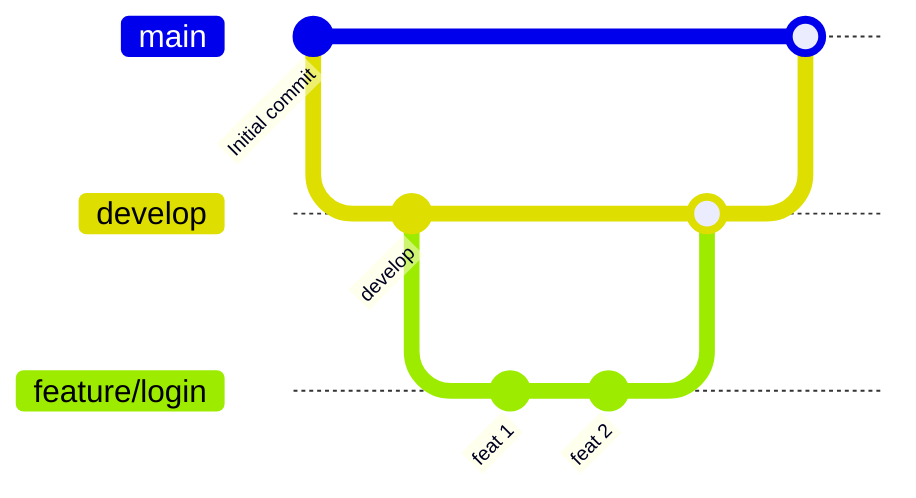

Συνοπτικά η ροή είναι:

1. Κόβεις το feature branch από το `develop`.
2. Ανοίγεις PR `feature/... → develop`.
3. Ο reviewer κάνει **Merge Squash** στο `develop` (τα commits του feature γίνονται ένα) και διαγράφει το feature branch στο remote.
4. Όταν το `develop` είναι σταθερό, ανοίγεται release PR `develop → main` με **Merge commit**.

Το `git fetch` δεν συγχωνεύει τίποτα, και το `develop` δεν παίρνει αυτόματα αλλαγές από το `main`. Το `main` αλλάζει μόνο από release PR, οπότε κανονικά δεν έχει commits που λείπουν από το `develop`.

### Ονοματολογία branches

| Τύπος | Παράδειγμα |
|-------|------------|
| Νέο feature | `feature/ticket-creation` |
| Διόρθωση σφάλματος | `bugfix/login-error` |
| Επείγουσα διόρθωση | `hotfix/fix-crash` |
| Τεκμηρίωση | `docs/update-readme` |

Χρησιμοποίησε πεζά γράμματα και παύλες, χωρίς κενά.

## 5. Εργασία με feature branch (βήμα προς βήμα)

### Βήμα 1: Ενημέρωση του `develop`

```powershell
git fetch origin
git checkout develop
git pull origin develop
```

Αν το τοπικό `develop` δεν υπάρχει ακόμα:

```powershell
git checkout -b develop --track origin/develop
```

### Βήμα 2: Δημιουργία feature branch από το `develop`

```powershell
git checkout -b feature/ticket-creation
```

### Βήμα 3: Δουλειά και commits

```powershell
git status
git add .
git commit -m "Προσθήκη φόρμας δημιουργίας ticket"
```

Κάνε μικρά, συχνά commits με περιγραφικά μηνύματα.

### Βήμα 4: Push του branch στο remote

Την πρώτη φορά:

```powershell
git push -u origin feature/ticket-creation
```

Στη συνέχεια αρκεί `git push`.

### Βήμα 5: Ενημέρωση με τις τελευταίες αλλαγές του `develop`

Αν το `develop` άλλαξε όσο δούλευες:

```powershell
git fetch origin
git merge origin/develop
# ή, για πιο «καθαρό» ιστορικό:
git rebase origin/develop
```

Αν υπάρχουν conflicts, δες την ενότητα 7.

### Εναλλακτικά: δημιουργία feature branch από το Codeberg (web UI)

Μπορείς να δημιουργήσεις το branch από τον browser, χωρίς terminal.

**Μέθοδος Α: από τη σελίδα Branches**

1. Συνδέσου στο Codeberg και άνοιξε `https://codeberg.org/ebomponis001/HelpDesk_Lite`.
2. Στην καρτέλα **Code** πάτησε το **branches** (π.χ. «2 branches») στη μπάρα πάνω από τα αρχεία.
3. Στη γραμμή του `develop` πάτησε το εικονίδιο **Create new branch from "develop"** (το πρώτο εικονίδιο από αριστερά στα δεξιά της γραμμής).

   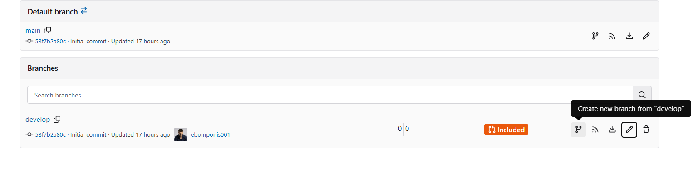

4. Στο παράθυρο **Create new branch** γράψε το όνομα στο πεδίο **Branch name**, π.χ. `feature/ticket-creation`, και πάτησε **Confirm**.

   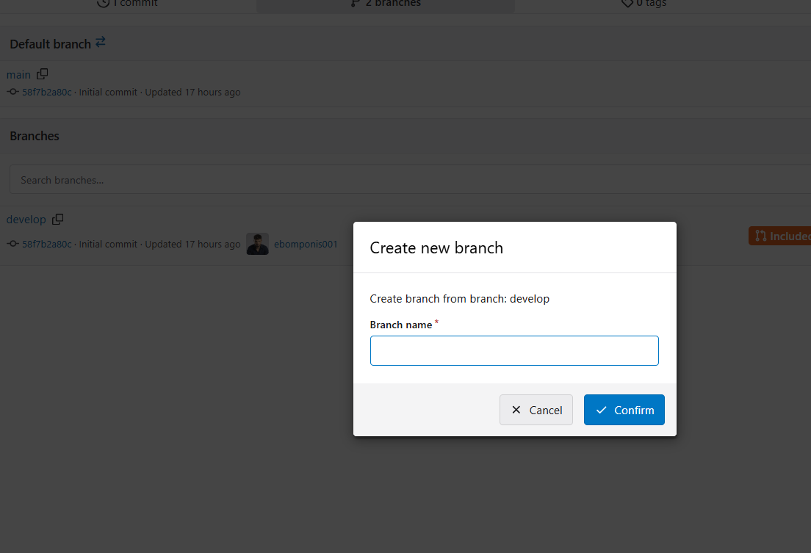

5. Το νέο branch εμφανίζεται στη λίστα και ο μετρητής ενημερώνεται (π.χ. «3 branches»).

   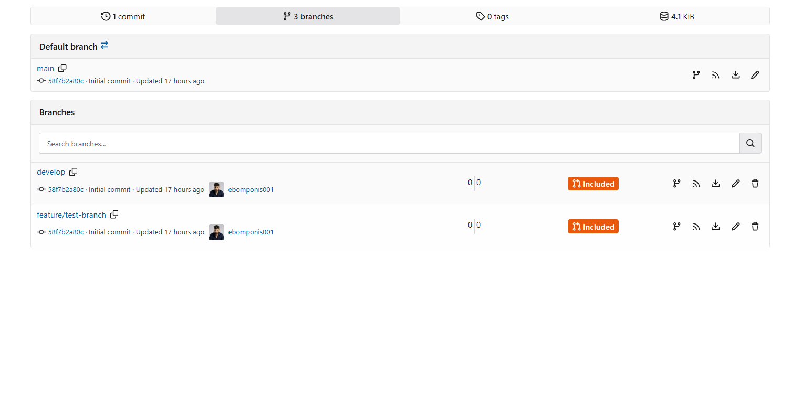

**Μέθοδος Β: από το dropdown των branches**

1. Στην καρτέλα **Code**, επίλεξε από το dropdown το `develop`.
2. Ξανάνοιξε το dropdown και πληκτρολόγησε το όνομα του νέου branch στο πεδίο αναζήτησης.
3. Πάτησε την επιλογή **Create branch … from 'develop'**.

Μετά, φέρε το νέο branch στον υπολογιστή σου:

```powershell
git fetch origin
git checkout feature/ticket-creation
```

> Η ακριβής διατύπωση των κουμπιών μπορεί να διαφέρει ελαφρώς ανάλογα με την έκδοση του Codeberg (Forgejo).

## 6. Άνοιγμα Pull Request στο Codeberg

1. Κάνε push το feature branch (Βήμα 4).
2. Άνοιξε το repo στο `https://codeberg.org/ebomponis001/HelpDesk_Lite`.
3. Πήγαινε στην καρτέλα **Pull requests** και πάτησε **New pull request**.

   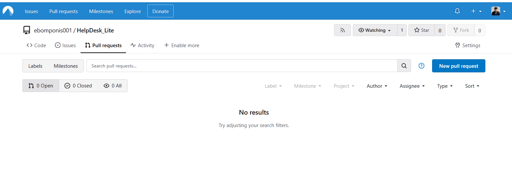

4. Επίλεξε:
   - **merge into (προς):** `develop`
   - **pull from (από):** `feature/ticket-creation`

   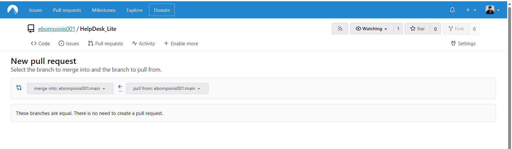

   Αν τα δύο branches είναι ίδια, εμφανίζεται το μήνυμα «These branches are equal. There is no need to create a pull request». Χρειάζεται τουλάχιστον ένα commit στο feature branch.
5. Συμπλήρωσε **τίτλο** (σε μορφή `<type>(<scope>): <subject>`) και **περιγραφή** (τι αλλάζει, γιατί, πώς δοκιμάστηκε). Αν υπάρχει σχετικό issue, γράψε `Closes #12`.

   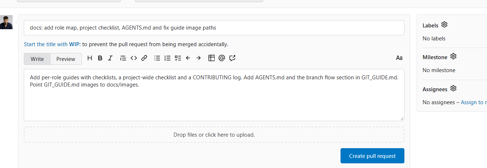

6. Πάτησε **Create pull request**. Μετά, από το πλευρικό πάνελ **Reviewers** πρόσθεσε τον reviewer.

   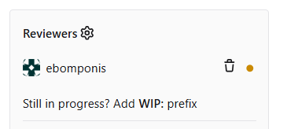

   Το PR εμφανίζεται ως **Open**, με τα commits και τα αρχεία που αλλάζουν.

   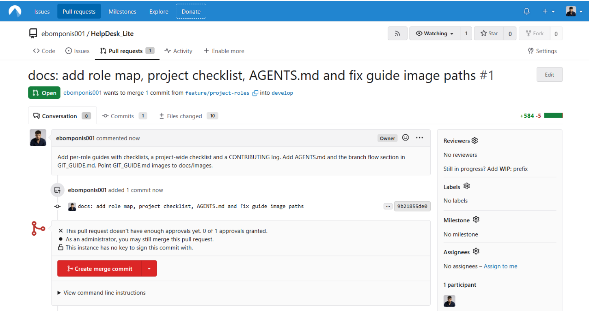

7. Απάντησε στα σχόλια του review αν υπάρχουν. Νέα commits στο ίδιο branch ενημερώνουν αυτόματα το PR.
8. Μετά την έγκριση, ο **reviewer** κάνει **Merge Squash** (ανάλογα με τη συμφωνία της ομάδας).
9. Η διαγραφή του feature branch στο **remote** γίνεται **μόνο από τον reviewer** (βλ. παρακάτω). Ο δημιουργός του PR διαγράφει μόνο το **τοπικό** branch:

```powershell
git checkout develop
git pull origin develop
git branch -d feature/ticket-creation   # μόνο τοπικά
git fetch --prune                       # καθαρισμός αναφορών σε remote branches που διαγράφηκαν
```

> Μετά από **Squash** το Git δεν αναγνωρίζει το τοπικό feature branch ως merged και το `git branch -d` μπορεί να αρνηθεί. Αφού επιβεβαιώσεις ότι το PR έγινε merge, χρησιμοποίησε `git branch -D feature/ticket-creation`.

> Ο δημιουργός του PR **δεν** τρέχει `git push origin --delete ...`.

### Για τον reviewer: merge και διαγραφή remote branch

1. Άνοιξε το PR στο Codeberg και έλεγξε τις αλλαγές (καρτέλα **Files changed**).
2. Πάτησε **Approve** αν όλα είναι σωστά.
3. Στο κάτω μέρος του PR άνοιξε το βελάκι δίπλα στο κουμπί merge και διάλεξε **Create squash commit** (για PR σε `develop`). Για release PR προς `main` διάλεξε **Create merge commit**.

   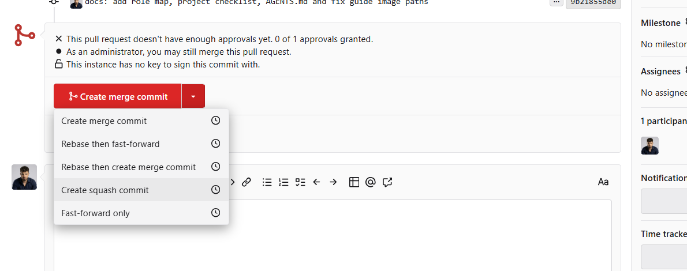

   Αν το PR δεν έχει τις απαιτούμενες εγκρίσεις (π.χ. «0 of 1 approvals granted»), ένας administrator μπορεί παρ' όλα αυτά να κάνει merge. Χρησιμοποίησέ το μόνο με συμφωνία της ομάδας.

4. Έλεγξε τον τίτλο και την περιγραφή του squash commit (ο τίτλος παίρνει αυτόματα το `(#αριθμός)` του PR) και πάτησε **Create squash commit**. Τσέκαρε το **Delete branch "…"** αν θέλεις να διαγραφεί το branch με το merge.

   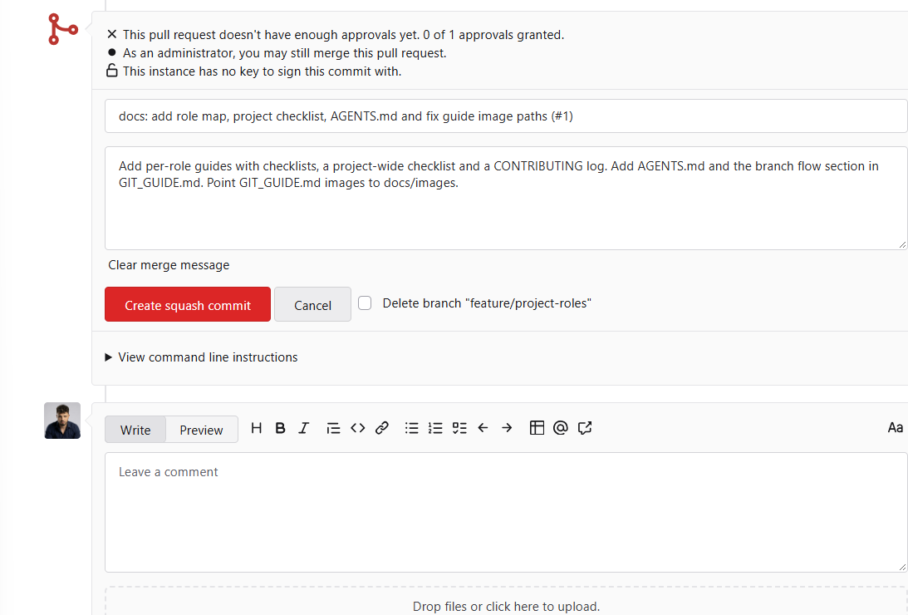

5. Αν δεν το τσέκαρες, μετά το merge το PR εμφανίζεται ως **Merged** και υπάρχει κουμπί **Delete branch** μέσα στο PR.

   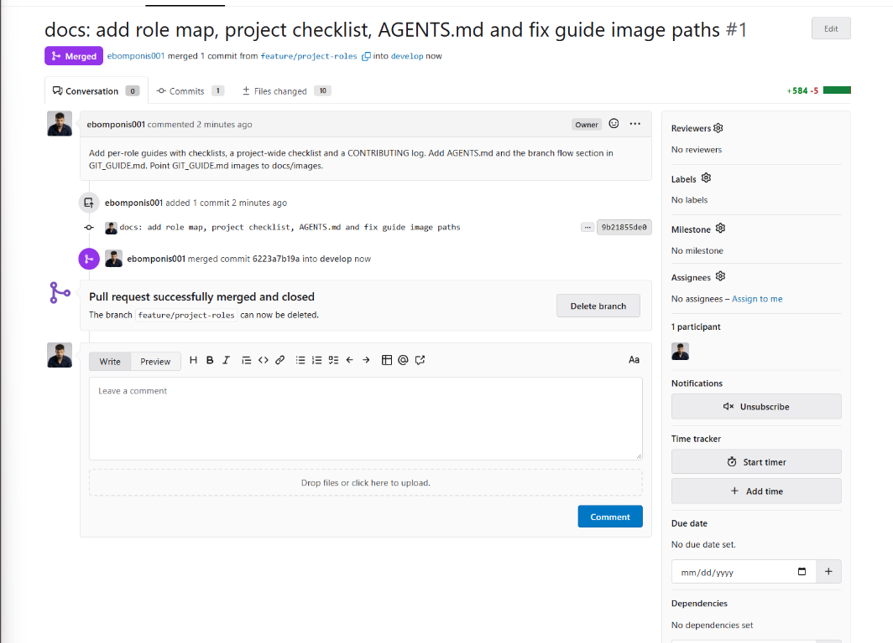

Εναλλακτικά, μέσω terminal:

```powershell
git push origin --delete feature/ticket-creation
```

Προσοχή: τα `main` και `develop` δεν διαγράφονται ποτέ. Μπορείς να τα προστατέψεις από **Settings → Branches → Protected branches**.

### Checklist πριν το PR

- [ ] Το branch βασίζεται στο πρόσφατο `develop`
- [ ] Ο κώδικας τρέχει και τα tests περνούν
- [ ] Δεν υπάρχουν περιττά αρχεία ή secrets (κωδικοί, tokens)
- [ ] Τα commit messages είναι κατανοητά

### Release: `develop` προς `main`

Όταν το `develop` είναι σταθερό, άνοιξε PR με **base:** `main` και **compare:** `develop`.

Στο release PR χρησιμοποίησε **Merge commit** και όχι Squash. Με Squash το `main` παίρνει ένα νέο commit που δεν υπάρχει στο `develop`, τα δύο branches φαίνονται αποκλίνοντα και το επόμενο release PR μπορεί να δείξει περιττά conflicts.

Αν γίνει αλλαγή απευθείας στο `main` (π.χ. hotfix), φέρε την στο `develop` με PR `main → develop` ή τοπικά:

```powershell
git fetch origin
git checkout develop
git merge origin/main
git push origin develop
```

## 7. Επίλυση conflicts

```powershell
git merge origin/develop
# Git: CONFLICT (content): Merge conflict in <αρχείο>
```

1. Άνοιξε το αρχείο και βρες τους δείκτες:

   ```
   <<<<<<< HEAD
   δική σου έκδοση
   =======
   έκδοση από το develop
   >>>>>>> origin/develop
   ```

2. Κράτησε τον σωστό κώδικα και σβήσε τους δείκτες.
3. Ολοκλήρωσε τη συγχώνευση:

   ```powershell
   git add <αρχείο>
   git commit
   git push
   ```

Για ακύρωση της συγχώνευσης: `git merge --abort`.

## 8. Χρήσιμες εντολές για branches

```powershell
git branch                      # Τοπικά branches
git branch -a                   # Τοπικά και remote branches
git checkout <branch>           # Μετάβαση σε branch
git switch <branch>             # Σύγχρονη εναλλακτική του checkout
git switch -c <νέο-branch>      # Δημιουργία και μετάβαση
git branch -d <branch>          # Διαγραφή τοπικού branch (μετά από merge)
git branch -D <branch>          # Εξαναγκασμένη διαγραφή
git fetch --prune               # Καθαρισμός διαγραμμένων remote branches
```

## 9. Καλές πρακτικές

- Μην κάνεις commit απευθείας στα `main` και `develop`. Χρησιμοποίησε feature branches και PRs.
- Ένα branch αντιστοιχεί σε μία εργασία.
- Κάνε `git pull` πριν ξεκινήσεις δουλειά.
- Γράφε σαφή commit messages, π.χ. «Προσθήκη φόρμας login».
- Μην κάνεις commit αρχεία με κωδικούς ή ευαίσθητα δεδομένα. Χρησιμοποίησε το `.gitignore`.
- Μην ξαναγράφεις ιστορικό (`rebase`, `push --force`) σε branches που μοιράζεσαι με άλλους.

## 10. Γρήγορη αναφορά

```powershell
git checkout develop
git pull origin develop
git checkout -b feature/όνομα
# ... αλλαγές ...
git add .
git commit -m "Μήνυμα"
git push -u origin feature/όνομα
# -> Άνοιγμα PR στο Codeberg: feature/όνομα -> develop
```
