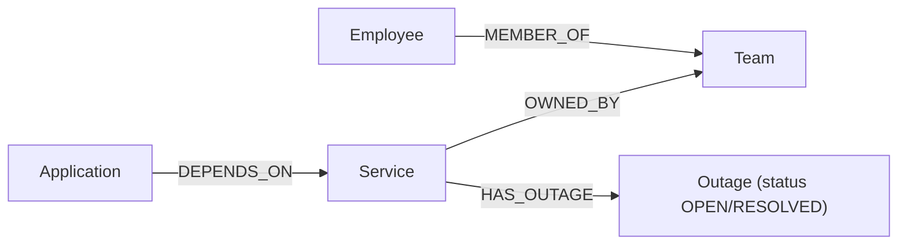

# Neo4j graph model

Keys: `employee_id`, `team_id`, `service_id`, `app_id`, `outage_id` (unique constraints).
Seeded by `python -m src.knowledge.seed_graph` (MERGE, idempotent). `check_graph` follows
`Application -DEPENDS_ON-> Service -HAS_OUTAGE-> Outage {status: 'OPEN'}`.
